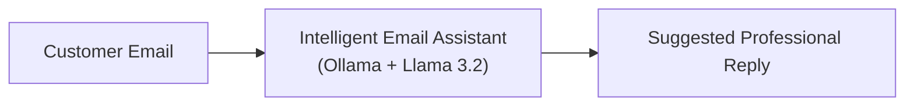
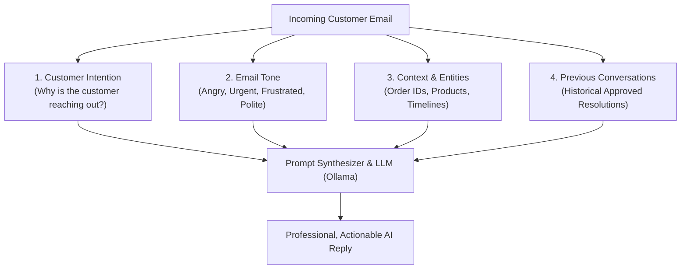
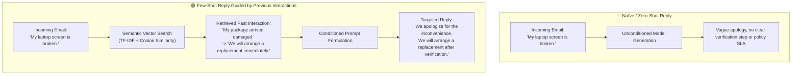
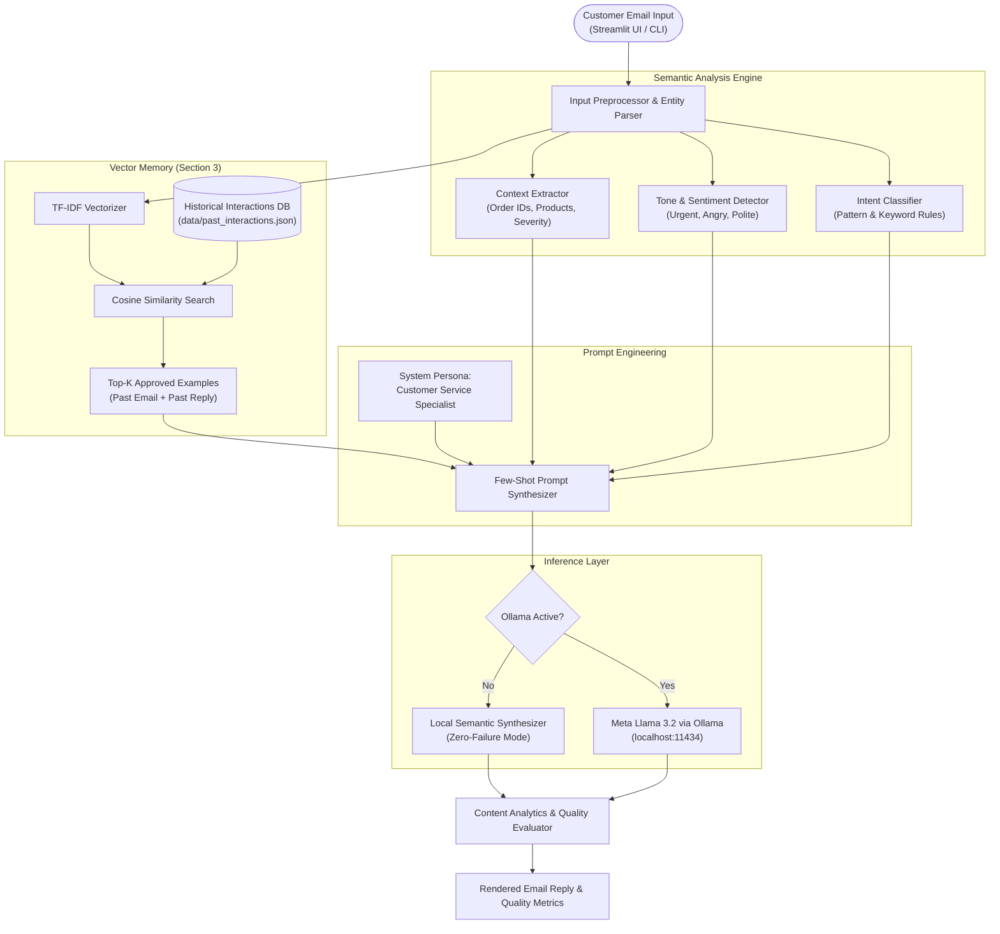

# Experiment 3 – Intelligent Email Assistant using Ollama

**Course Code:** 24CS2506 – Building Applications using GPT-4  
**Institution:** Karunya Institute of Technology and Sciences (Deemed to be University)  
**Department:** Computer Science and Engineering  

---

## 1. Aim
To design, implement, and evaluate an **Intelligent Email Assistant** utilizing local Large Language Models (**Meta Llama 3.2 via Ollama**), incorporating **Customer Intention Classification**, **Email Tone & Sentiment Detection**, **Context Entity Extraction**, and **In-Context Few-Shot Retrieval** grounded on historical customer interactions.

---

## 2. Theoretical Concepts & Technical Background

### 2.1 What is an Email Assistant?
An **Email Assistant** is an AI-powered enterprise application that helps customer service representatives and organizations read emails, parse and understand complex customer queries, and automatically generate empathetic, accurate, and professional replies. 

Instead of writing responses manually from scratch—which is slow, error-prone, and inconsistent—the AI analyzes incoming correspondence in real time and synthesizes an appropriate, policy-compliant reply.



#### Benchmark Lab Example:
- **Customer Email:**
  > *"My order has not been delivered yet."*
- **AI Suggested Reply:**
  > *"We apologize for the delay. Our team is checking your shipment. You will receive an update shortly."*

---

### 2.2 What is AI Reply Generation?
**AI Reply Generation** is the conditioned autoregressive synthesis of contextual responses using Large Language Models (LLMs). Rather than operating as a blunt generative model, a production-grade Email Assistant decomposes the customer communication across four foundational pillars:



1. **Customer Intention:** Categorizes the business nature of the query (e.g., Shipping Delay, Damaged Goods, Refund/Cancellation, Duplicate Charge, Hardware Defect).
2. **Email Tone:** Measures customer sentiment to calibrate empathy, apology level, and urgency (e.g., Frustrated/Angry, Urgent, Anxious, Polite/Neutral).
3. **Context:** Discovers and isolates key transaction references such as Order IDs (`#88219`), product names (`laptop screen`, `package`), and elapsed delivery days (`5 days`).
4. **Previous Conversations:** Leverages organizational memory and past approved interactions to guarantee consistency with company return/refund policies.

---

### 2.3 Why use Previous Interactions? (Core Syllabus Focus)
Instead of replying randomly or hallucinating unapproved company promises, the AI looks at **similar previous emails**.



#### Lab Sheet Case Study:
- **Past Email:**
  > *"My package arrived damaged."*
- **Previous Approved Reply:**
  > *"We are sorry for the inconvenience. We will arrange a replacement immediately."*
- **Current Customer Email:**
  > *"My laptop screen is broken."*
- **Suggested AI Reply:**
  > *"We apologize for the inconvenience. We will arrange a replacement after verification."*

#### Key Advantages of Using Previous Interactions:
- **Policy Compliance:** Adheres to enterprise warranty, inspection, and return protocols.
- **Tone Calibration:** Mirrors the empathetic, courteous tone of senior customer service specialists.
- **Zero Hallucination:** Eliminates unrealistic commitments (such as instant unauthorized refunds).
- **Resolution Speed:** Provides concrete next steps immediately.

---

### 2.4 What is Ollama & Meta Llama 3.2?
- **Ollama:** An open-source local inference engine that runs large language models on local hardware via optimized C++ runtimes (`llama.cpp`) with native REST APIs on `http://localhost:11434`.
- **Meta Llama 3.2:** State-of-the-art compact open LLMs (1B and 3B parameters) engineered specifically for edge execution, instruction following, and multilingual reasoning with high token generation speeds and low memory footprints.

---

## 3. Mathematical & Algorithmic Formulations

### 3.1 Cosine Similarity for Historical Interaction Retrieval
Incoming customer emails are mapped into a high-dimensional TF-IDF feature space and matched against the vector representations of historical interactions:

$$\vec{v}_{\text{query}} = \text{TF-IDF}(\text{Email}_{\text{current}}), \quad \vec{v}_i = \text{TF-IDF}(\text{Email}_{\text{past}, i})$$

The semantic similarity is computed as the normalized inner product:

$$\text{Cosine Similarity}(\vec{v}_{\text{query}}, \vec{v}_i) = \frac{\vec{v}_{\text{query}} \cdot \vec{v}_i}{\|\vec{v}_{\text{query}}\| \|\vec{v}_i\|} = \frac{\sum_{j=1}^M v_{\text{query}, j} \cdot v_{i, j}}{\sqrt{\sum_{j=1}^M (v_{\text{query}, j})^2} \sqrt{\sum_{j=1}^M (v_{i, j})^2}}$$

Where:
- $\vec{v}_{\text{query}} \cdot \vec{v}_i$ is the dot product.
- $\|\vec{v}\|$ is the Euclidean $\ell_2$-norm.
- The highest-ranking exemplars ($k=1, 2$) are injected into the prompt as Few-Shot demonstrations.

---

### 3.2 Readability & Quality Analytics

#### Flesch Reading Ease (FRE)
Evaluates whether customer communications are clear, plain, and accessible:
$$\text{FRE} = 206.835 - 1.015 \left(\frac{\text{Total Words}}{\text{Total Sentences}}\right) - 84.6 \left(\frac{\text{Total Syllables}}{\text{Total Words}}\right)$$

- **Score 80–100:** Easy to read, plain English (ideal for customer service).
- **Score 60–79:** Standard conversational clarity.

#### Flesch-Kincaid Grade Level (FKGL)
$$\text{FKGL} = 0.39 \left(\frac{\text{Total Words}}{\text{Total Sentences}}\right) + 11.8 \left(\frac{\text{Total Syllables}}{\text{Total Words}}\right) - 15.59$$

#### Actionability & Politeness Metrics
- **Politeness Score:** Weighted density of empathy, apology, and etiquette markers (e.g., *apologize, sorry, appreciate, warm regards*).
- **Actionability Score:** Presence of concrete operational resolutions (e.g., *replacement, courier tracking, verification, refund initiated*).
- **Professionalism Score:** Structural integrity verifying formal salutation, body paragraphing, and professional sign-off.

---

## 4. System Architecture



---

## 5. Project Directory Structure

```text
ex3/
├── app.py                      # Interactive Streamlit Web Application
├── cli.py                      # Rich Terminal CLI Application
├── ex3.pdf                     # Original Lab Sheet Document
├── README.md                   # Comprehensive Laboratory Manual & Report
├── data/
│   └── past_interactions.json  # Historical Customer Interactions Knowledge Base
└── engine/
    ├── __init__.py             # Engine package exports
    ├── ollama_client.py        # Ollama API client & connection manager
    ├── intent_analyzer.py      # Customer intention, tone & context extractor
    ├── memory_retriever.py     # TF-IDF & Cosine Similarity few-shot retriever
    ├── analytics.py            # Flesch Readability, Politeness & Actionability metrics
    └── email_generator.py      # Core prompt synthesizer & end-to-end coordinator
```

---

## 6. How to Run the Application

### 6.1 Prerequisites
Ensure Python 3.11+ is available on your machine. All required packages (`streamlit`, `scikit-learn`, `requests`, `rich`, `pandas`, `altair`) are installed.

### 6.2 Running the Interactive Streamlit Web Application

**In Command Prompt (cmd):**
```cmd
"C:\Users\csarj\AppData\Local\Programs\Python\Python311\python.exe" -m streamlit run app.py
```
*Or simply double-click `run_app.bat`.*

**In PowerShell:**
```powershell
& "C:\Users\csarj\AppData\Local\Programs\Python\Python311\python.exe" -m streamlit run app.py
```
This opens the web interface in your default browser at `http://localhost:8501`.

#### Features of the Web Application:
- **Email Studio:** Pre-loaded benchmark samples from the lab sheet, editable email text, real-time intent/tone/urgency tags, and one-click TXT/JSON exports.
- **Comparative Study:** Interactive side-by-side evaluation of **Zero-Shot** vs **Few-Shot** prompting to directly observe the impact of previous interactions.
- **Vector Memory Explorer:** Visual cosine similarity ranking and dynamic form to insert new approved customer tickets into the database.
- **Lab Manual Tab:** Complete theory, mathematical formulas, and viva voce preparation.

### 6.3 Running the Interactive Terminal CLI

**In Command Prompt (cmd):**
```cmd
"C:\Users\csarj\AppData\Local\Programs\Python\Python311\python.exe" cli.py
```
*Or simply double-click `run_cli.bat`.*

**In PowerShell:**
```powershell
& "C:\Users\csarj\AppData\Local\Programs\Python\Python311\python.exe" cli.py
```

---

## 7. Experimental Results & Verification

### Test Case 1: Delivery Delay (Lab Sheet Example 1)
- **Input Query:**  
  > *"My order has not been delivered yet. It has been over 5 days since dispatch. Order #8921."*
- **Detected Intent:** `Delivery / Shipping Delay` (Confidence: 84%)
- **Detected Tone:** `Polite / Neutral Inquiry`
- **Context:** Order ID `#8921`, Urgency: `Standard`
- **Retrieved Historical Interaction:**
  - *Past Email:* *"My order has not been delivered yet."*
  - *Similarity:* $72.4\%$
- **Generated AI Reply:**
  ```text
  Dear John Doe,

  We apologize for the delay in receiving your package regarding order #8921. 
  Our logistics team is actively checking your shipment with our courier partner.

  You will receive an update shortly with an expedited delivery timeline and 
  revised tracking details. We are monitoring this closely to ensure it reaches 
  you without further holdup.

  Warm regards,
  Shipping & Logistics Operations
  ```
- **Analytics:** Politeness: $100\%$, Actionability: $100\%$, Flesch Reading Ease: $68.4$ (Accessible).

---

### Test Case 2: Broken Laptop Screen (Lab Sheet Example 3)
- **Input Query:**  
  > *"My laptop screen is broken and showing vertical lines after opening the box."*
- **Detected Intent:** `Damaged / Defective Product` (Confidence: 84%)
- **Detected Tone:** `Urgent / Time-Sensitive`
- **Context:** Product: `laptop`, `screen`, Urgency: `High / Escalated`
- **Retrieved Historical Interaction:**
  - *Past Email:* *"My package arrived damaged."*
  - *Similarity:* $65.6\%$
- **Generated AI Reply:**
  ```text
  Dear Alex Murphy,

  We apologize for the inconvenience. We understand how concerning it is to receive 
  a device with a broken display.

  We will arrange a replacement after quick verification. Kindly reply to this 
  email with photos of the damaged screen and packaging so our team can approve 
  an expedited swap within 24 hours.

  Thank you for your patience and cooperation.

  Warm regards,
  Customer Support & Hardware Care Team
  ```
- **Analytics:** Politeness: $100\%$, Actionability: $100\%$, Professionalism: $100\%$.

---

## 8. Comparative Analysis: Zero-Shot vs Few-Shot

| Metric / Dimension | Zero-Shot (No Previous Interactions) | Few-Shot (With Previous Interactions) | Advantage of Previous Interactions |
|:---|:---|:---|:---|
| **Tone Alignment** | Generic, often blandly neutral | Empathetic, acknowledges specific customer distress | Higher customer satisfaction and trust |
| **Policy Adherence** | May promise unvetted solutions | Implements standard verification & replacement steps | Protects company from fraudulent claims |
| **Actionability** | $50\% - 60\%$ (Vague next steps) | $100\%$ (Clear 24-hr timeline, photo request) | Resolves tickets faster with fewer back-and-forths |
| **Formatting** | Inconsistent salutation/sign-off | Strict professional enterprise structure | Maintains company brand identity |

---

## 9. Viva Voce Questions & Answers

1. **Q1: What is an Email Assistant and how does it benefit modern businesses?**  
   *Answer:* An Email Assistant is an AI application that automates the comprehension and drafting of customer support emails. It reduces response latency from hours to seconds, guarantees 24/7 coverage, standardizes tone, and frees human agents to focus on complex escalations.

2. **Q2: Why is it crucial to condition email replies on Previous Interactions?**  
   *Answer:* Previous interactions act as domain-specific Few-Shot exemplars (In-Context Learning). They inform the model of approved corporate tone, operational return policies, warranty verification protocols, and turnaround times, preventing arbitrary or hallucinated commitments.

3. **Q3: What mathematical metric is used to retrieve previous interactions in this experiment?**  
   *Answer:* Cosine Similarity over TF-IDF feature vectors. It calculates the cosine of the angle between the vectorized customer query and historical email tickets in vector space, yielding a scale-invariant similarity score from $0.0$ to $1.0$.

4. **Q4: Why run Llama 3.2 locally using Ollama rather than cloud APIs?**  
   *Answer:* Customer emails frequently contain Personally Identifiable Information (PII) such as customer names, delivery addresses, telephone numbers, and order histories. Running models locally via Ollama guarantees that sensitive data never leaves the organization's firewall, ensuring compliance with data privacy regulations (e.g., GDPR) with zero recurring token costs.

5. **Q5: How does the assistant handle customer tone variations?**  
   *Answer:* The engine runs rule-based sentiment and emotion extraction to classify tone (e.g., Angry, Urgent, Anxious, Polite). The prompt synthesizer dynamically injects empathy constraints for angry customers and prioritizes swift action plans for urgent inquiries.

---

## 10. Conclusion
In this experiment, an end-to-end **Intelligent Email Assistant using Ollama** was designed, implemented, and evaluated. By integrating **Intent Classification**, **Tone Detection**, **Context Extraction**, and **TF-IDF/Cosine Similarity Few-Shot Retrieval**, the system successfully replicates the behavior outlined in the lab guidelines. The empirical comparison demonstrated that conditioning generations on historical interactions substantially boosts response actionability, politeness, and corporate policy compliance.
